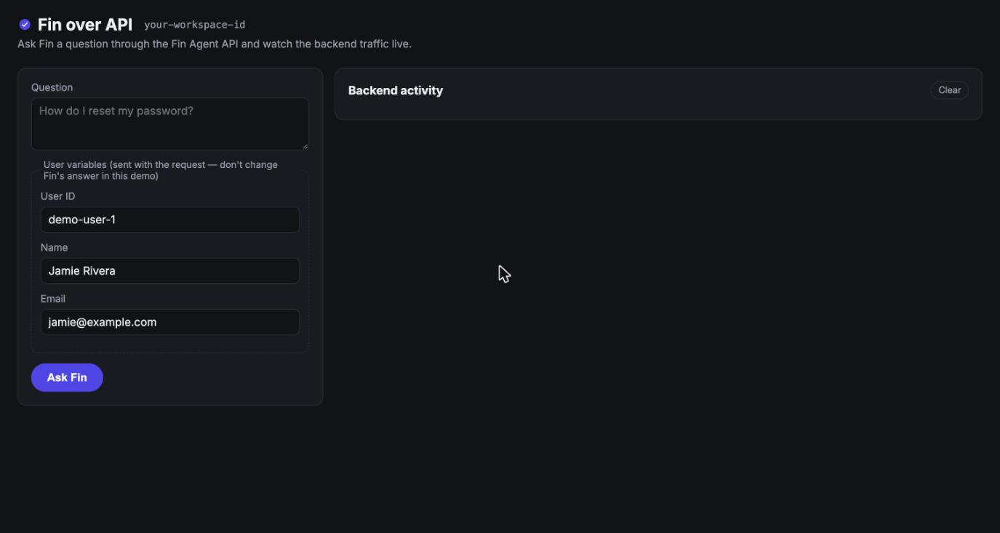

# Fin over API — demo

A small local app that asks [Intercom's Fin](https://www.intercom.com/fin) a question through the
[Fin Agent API](https://developers.intercom.com/docs/references/fin-agent-api) and shows the
backend HTTP traffic live while it answers.



## What it does

- Submits a question (plus optional cosmetic user attributes) to `POST /fin/ask`.
- Fin's real answer only arrives asynchronously, normally via a webhook to a public callback
  URL. Since this runs on localhost with no public URL, the app instead **polls**
  `GET /conversations/{id}` until Fin's reply shows up, and then **simulates** the webhook
  delivery that would otherwise have fired (clearly labeled `WEBHOOK (sim)` in the log).
- A real webhook receiver is also wired up at `POST /api/webhook/fin-agent` — point a public
  tunnel at it and genuine webhooks will log unmarked as simulated.
- Every request/response, including the simulated webhook, streams into the UI over
  server-sent events.

## Setup

```bash
npm install
cp .env.example .env
# edit .env with your workspace's Fin Agent API key and app id
npm start
```

Then open `http://localhost:4790`.

### Getting a Fin Agent API key

In your Intercom workspace: **Settings → Integrations → Fin Agent API** (requires the feature to
be enabled for your workspace) → generate a key. By default the key can post to `/fin/ask` but
may not have scope to read conversations back — if polling returns 401/403, set
`FALLBACK_READ_TOKEN` in `.env` to a personal access token that can read conversations.

## Notes

- No credentials are ever logged to the UI — the Authorization header is redacted to its last 4
  characters in the live activity log.
- This is a demo/reference tool, not a production integration pattern — the real way to consume
  Fin's async reply is a public webhook endpoint, not polling.
